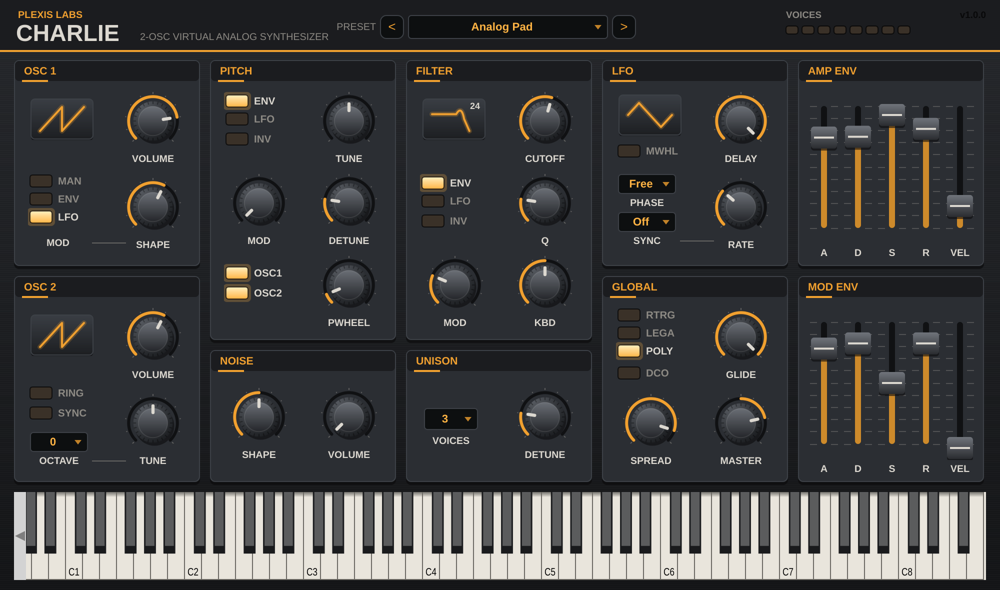

# PLEXIS Labs — Charlie

Synthétiseur virtuel analogique à 2 oscillateurs (VST3 + application autonome),
inspiré de **Charlatan 2.0** (BlauKraut Engineering). Construit avec JUCE 8 + CMake.



## Compiler via GitHub (Windows)
1. Pousser ce dossier dans un dépôt GitHub (branche quelconque).
2. L'onglet **Actions** lance `Build Charlie (Windows VST3)` automatiquement
   (ou *Run workflow* manuellement).
3. Le workflow configure CMake (JUCE est téléchargé automatiquement), compile et
   **exécute les tests DSP**, puis compile le VST3 et le Standalone.
4. Télécharger l'artefact `Charlie-VST3-Windows-x64` et copier le dossier
   `Charlie.vst3` dans `C:\Program Files\Common Files\VST3\`.

Compilation locale : `cmake -B build -A x64` puis `cmake --build build --config Release`
(option `-DJUCE_DIR=chemin` pour utiliser une copie locale de JUCE).

## Fonctions (fidèles à Charlatan 2)
| Section | Contrôles |
|---|---|
| OSC 1 | Forme (Sine/Tri/Saw/Pulse), Volume, SHAPE + modulation MAN/ENV/LFO |
| OSC 2 | Forme, Volume, RING, SYNC (synchro dure sur OSC 1), Octave ±2, Tune ±12 dt |
| PITCH | Source ENV/LFO, INV, Tune (±100 ct), Mod (jusqu'à 36 dt), Detune, cibles OSC1/OSC2, Pitch wheel 0–24 dt |
| NOISE | Bruit stéréo, Shape (sombre → blanc → brillant), Volume |
| FILTER | LP 24 dB (échelle Moog ZDF), LP 12 dB et BP (SVF), Cutoff, Q (auto-oscillation), Mod ENV/LFO + INV, KBD |
| UNISON | 1 à 7 voix, Detune, image stéréo |
| LFO | 7 formes, MWHL (molette = profondeur), Delay, Phase (libre/0/90/180/270°), synchro tempo hôte, Rate |
| GLOBAL | RTRG / LEGA / POLY (8 voix), DCO (désactive la dérive analogique), Glide, Spread, Master |
| ENV ×2 | A, D, S, R, VEL (sensibilité à la vélocité) |

Extras : clavier à l'écran, pédale de maintien (CC64), 10 presets d'usine, suréchantillonnage ×2
des voix (oscillateurs + filtre saturé) avec décimation FIR demi-bande.

## Architecture
```
Source/
  dsp/            moteur C++ pur (aucune dépendance JUCE, testable seul)
    DspCommon.h   constantes : kNumOscillators = 2, kMaxPolyphony = 8, kMaxUnison = 7
    Oscillator.h  PolyBLEP à forme modulable
    Filters.h     Ladder 24 dB + SVF 12 dB / BP
    Envelope.h    ADSR type RC   Lfo.h   Decimator.h (×2)
    Voice.h       N osc × U unissons -> bruit -> filtre stéréo -> VCA
    SynthEngine.h allocation des voix, mono/legato/poly, glide, sustain
  Parameters.*    paramètres automatisables (APVTS) -> SynthParams
  Presets.h       banque d'usine
  gui/            PlexisLookAndFeel.h (thème de marque), Controls.h
tests/dsp_tests.cpp   tests sur signaux synthétiques (exécutés par la CI)
```

## Feuille de route
- **Charlie 3 (Model D poly)** : `kNumOscillators = 3`, 3e oscillateur, mélangeur à 3 voies,
  rétroaction du mélangeur (« overdrive » à la Minimoog), OSC 3 en LFO.
- **Charlie 4 (Mono/Poly / Seer Reality)** : 4 oscillateurs, modes de distribution
  (unisson / chord / poly 4), cross-mod et sync en chaîne.
Le moteur est indexé par oscillateur : la voix, le mélangeur et le routage de hauteur
bouclent déjà sur `kNumOscillators`.
